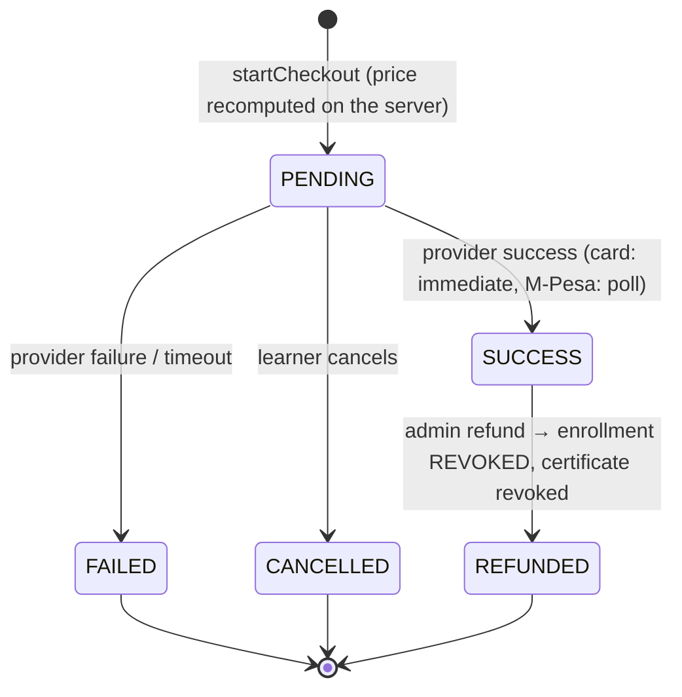

# Architecture

## Layers

```
Browser ──► proxy.ts (CSP nonce, optimistic redirects)
        ──► Server Components / Server Actions / Route Handlers
              │   every one calls a guard in src/lib/dal.ts
              ▼
            domain + services (src/lib/**)  ──►  adapters  ──►  Postgres / S3 / Resend / (payment rails)
```

| Concern | Interface | Implementations | Selected by |
|---|---|---|---|
| Email | `EmailProvider.send` | `ConsoleEmailProvider` (dev; also writes admin notifications), `ResendEmailProvider` | `EMAIL_PROVIDER` |
| Storage | `StorageProvider` (`putObject`, `getObject`, `presignPut`, `getSignedUrl`, `publicUrl`, `delete`) | `LocalStorageProvider` (`.storage/`, served by `/media/*` + `/api/upload/local`), `S3StorageProvider` (R2/S3/B2, public + private buckets) | `STORAGE_PROVIDER` |
| Payments | `PaymentProvider` (`initiate`, `getStatus`, `handleWebhook`, `refund`) | `SimulatedMpesaProvider`, `SimulatedCardProvider` | `PAYMENTS_MODE` |
| Rate limiting | `RateLimiter` (`consume`, `peek`, `reset`) | Postgres (default), Upstash REST, memory (dev/tests only) | `RATE_LIMIT_PROVIDER` |
| Video | lesson `content` = `{source: file\|youtube\|vimeo, key\|url, captions[]}` | native `<video>` for files, sandboxed iframe for YouTube/Vimeo | per lesson |
| Analytics | `AnalyticsAdapter.track` | console | `ANALYTICS_PROVIDER` |
| Auth providers | `accounts(providerId, providerAccountId)` | `credential`; `google` designed (`linkOrCreateOAuthUser`) | `AUTH_GOOGLE_ENABLED` |

Pure business rules (no I/O, fully unit-tested) live in `src/lib/domain/`: pricing + coupons, enrollment gate, progress + sequential locking, quiz grading.

## Auth flow

```mermaid
sequenceDiagram
  participant B as Browser
  participant A as Server action
  participant D as Postgres
  participant E as Email provider
  B->>A: signup(name,email,password)
  A->>D: rate-limit signup:ip (5/h)
  alt email is new
    A->>D: create user + credential account (bcrypt 12)
    A->>D: store sha256(verify token), 24h
    A->>E: "Verify your email" link
  else email exists
    A->>E: "Someone tried to sign up" notice
  end
  A-->>B: redirect /signup/check-inbox   (identical either way, no session)
  B->>A: GET /verify-email?token=…
  A->>D: UPDATE token SET usedAt WHERE hash=… AND usedAt IS NULL AND not expired
  A->>D: user.emailVerifiedAt = now
  B->>A: login(email,password,remember)
  A->>D: peek login:email / login:ip (5 / 20 per 15 min)
  A->>A: bcrypt compare (dummy hash if no such user)
  A->>D: create session(sha256(token)); cookie r.<token> | s.<token>
  B->>A: any request
  A->>D: sessions.tokenHash → user (status/deleted checked, sliding expiry)
```

Reset: `RESET_PASSWORD` token (1 h, single-use) → new password → **all sessions revoked** → "password changed" email.
Sessions page: list, revoke one, revoke all others. Suspension and deletion revoke every session immediately.

## Access-control model

Enforced server-side in `src/lib/dal.ts`; `proxy.ts` only redirects guests early.

| Resource | Guest | Learner | Admin |
|---|---|---|---|
| Catalog, course page, intro video | ✓ | ✓ | ✓ (drafts too, with banner) |
| Free-preview lesson body | ✓ (`getLessonView`) | ✓ | ✓ |
| Paid lesson body / signed media URL | ✗ 401/403 | active enrollment only (+ sequential rule) | ✓ |
| `/learn/:slug`, notes, progress | ✗ | active enrollment | ✓ (progress recorded only with an enrollment) |
| Certificate page / PDF | ✗ | owner; **PDF needs verified email**; revoked → 410 | ✓ |
| Invoice PDF | ✗ | owner | ✓ |
| `/verify/:code` | ✓ | ✓ | ✓ |
| `/admin/*`, CSV exports, previews | **404** | **404** | ✓ |
| `/media/private/*` | needs valid HMAC + unexpired | same | same |

Guards: `requireUser()`, `requireVerifiedUser()`, `requireAdmin()` (404), `getCourseAccess()`, `requireEnrollment()`, `getAdminOrNull()` for route handlers, plus `getLessonView()` as the single door to lesson content.

## Payment state machine



`PENDING → SUCCESS` runs in one transaction under an advisory lock: payment marked, invoice number from a DB sequence, coupon usage recorded, enrollment created/reactivated, notification written; emails and analytics fire after commit. Only `UPDATE … WHERE status='PENDING'` can win, so duplicates are no-ops.

## Data model (summary)

`User` (role, status, `emailVerifiedAt`, `deletedAt`, `notificationPrefs`) → `Account` (credential/google) · `Session` (token hash) · `VerificationToken` (purpose, hash, expiry, `usedAt`, meta).
`Category` → `Course` (+ outcomes/requirements/audience, `SlugRedirect`) → `Module` → `Lesson` (`content` jsonb by type, `passMark`) → `QuizQuestion` → `QuizOption`.
`Enrollment` (status ACTIVE/REVOKED) → `LessonProgress` · `QuizAttempt` · `Payment`\* · `Certificate` (code, snapshot, `pdfKey`, `revokedAt`).
`Payment` (idempotency key, subtotal/discount/amount, invoice number, card brand+last4 only) · `Coupon` → `CouponCourse` · `CouponUsage` · `Sequence`.
`Review` (soft-delete, reply) → `ReviewVote` · `LessonNote` · `LessonComment` · `Wishlist`.
Ops: `AuditLog`, `EmailLog`, `Notification`, `Setting` (jsonb), `Faq`, `Subscriber`, `ContactSubmission`, `StudentNote`, `RateLimit`.

All timestamps are `timestamptz`, money is integer KES, FKs are indexed, slugs/emails/codes are unique, users/courses/reviews are soft-deleted.

## Request-time security layers

1. `proxy.ts`: per-request CSP nonce; redirect cookie-less visitors away from protected prefixes; slide the remember-me cookie.
2. `next.config.ts`: `X-Content-Type-Options`, `X-Frame-Options`, `Referrer-Policy`, `Permissions-Policy`, COOP, HSTS (production).
3. Server actions: Next's built-in Origin/Host check (CSRF) + Zod validation + guard + rate limit where abusable.
4. Output: `sanitizeRichText` on write and render; JSON-LD escaped; CSV formula-injection neutralised; open-redirect guard on every `redirect` parameter.
5. Storage: private objects only via short-lived HMAC/S3 signed URLs; uploads validated by MIME, size and magic bytes.
